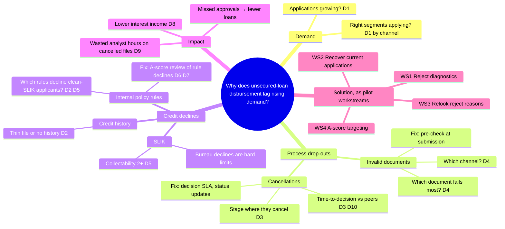

# Mind map: why disbursement lags demand (issue tree)

Rendered image: `slides/mindmap.png`. Use it as the appendix slide, or show it during Q&A
when someone asks "did you consider X?". The tree is MECE at each level: every lost
application leaves the funnel through exactly one branch.

## Issue tree with hypotheses and tests

| Branch | Hypothesis | Analysis that confirms or kills it | Data |
|---|---|---|---|
| Demand | Applications are growing faster than disbursements | Indexed monthly trend, applications vs disbursed | [D1] |
| Process: documents | Most document failures come from 1–2 documents (e.g. payslip, NPWP) and are fixable at submission | Failures by document type × channel | [D4] |
| Process: speed | Applicants who wait longer cancel more | Cancel rate by days-to-decision bucket | [D3][D10] |
| Credit: SLIK | SLIK explains a minority of credit declines | Share of declines with SLIK collectability 2+ | [D2][D5] |
| Credit: rules | Internal rules decline many applicants with clean SLIK | Rule declines where SLIK = 1 (current) | [D2][D5] |
| Credit: A-score | Some rule-declined applicants rank as low-risk as the approved book | Rule declines by A-score band vs approved-book bad rate per band | [D6][D7] |
| Impact | The leak is material in IDR | Lost approvals × avg ticket × yield; hours × cost | [D1][D8][D9] |

**Known limitation (say it before the panel does):** declined applicants have no repayment
history, so their risk is inferred from the approved book's bad rate in the same A-score band.
This is the reject-inference problem. That is why the recommendation is a capped pilot with
a DPD trigger, not a policy change.
